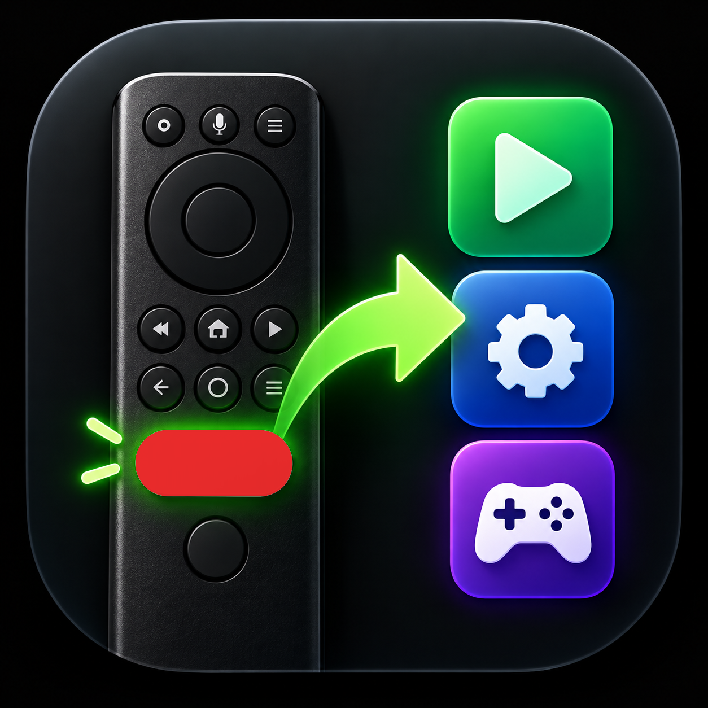

# shield-netflix-button

Make the Netflix button on the NVIDIA SHIELD remote open the app you want.

The SHIELD 2019 remote has a Netflix button that can't be remapped. Uninstall Netflix and
the button opens the Play Store page to install it again. This is a tiny app that
installs under Netflix's package name, so the SHIELD treats Netflix as installed, and it
opens the app you picked instead (YouTube until you choose something else).

No permissions, no network access, and no UI beyond an app picker.

## Compatibility

Tested on a SHIELD TV 2019 (tube) with the 2019 remote, Android TV 11, build
`RQ1A.210105.003`. Other SHIELD models on the same software will probably work but
haven't been tried. If you try one, open an issue either way.

It only works on a SHIELD, because the part that handles the button is NVIDIA's.

## Install

1. **Uninstall Netflix** (Settings > Apps > Netflix > Uninstall). The stub can't install
   while the real Netflix is there, because they share a package name.
2. **Install the APK** from [Releases](../../releases/latest).
   - With adb: `adb install netflix-stub-<version>.apk`
   - Without adb: get the APK onto the SHIELD (a file manager, Downloader, Send Files to
     TV, etc.) and install it from there. You'll need to allow that app to install
     unknown apps.
3. **Open the "Netflix button" app once** and pick an app. Don't skip this. Android
   doesn't deliver the button press to a newly installed app until it has been opened.

## Use

- **Netflix button:** opens the app you picked.
- **Change the app:** open "Netflix button" again and pick another one.
- **From adb:** `adb shell am start -n com.netflix.ninja/.Picker --es target <package>`

Things to know:

- If you **Force stop** the app or **Clear data** in Settings, the button does nothing
  until you open the app again. Clear data also resets the choice to YouTube. Reboots
  are fine.
- If the app you picked gets uninstalled, the button falls back to YouTube.
- Keep the app visible in your launcher. Opening it is how you fix the Force stop case.
- The Play Store won't put real Netflix over the stub. To get Netflix back, uninstall
  the stub first.

## Uninstall

Settings > Apps > Netflix button > Uninstall, or `adb uninstall com.netflix.ninja`. The
button goes back to opening the Play Store page, or Netflix if you reinstall it.

## How it works

When you press the button, NVIDIA's system service checks whether Netflix
(`com.netflix.ninja`) has a TV launcher entry. If it does, the service sends Netflix a
broadcast. If it doesn't, the service opens the Play Store. The stub has a launcher entry
(the picker) and a receiver for that broadcast, and the receiver opens your app. More
detail, including the approaches that didn't work: [docs/how-it-works.md](docs/how-it-works.md).

## Building

See [BUILDING.md](BUILDING.md).

## Disclaimer

Not affiliated with Netflix or NVIDIA. The stub uses Netflix's package name only because
that's the name the SHIELD looks for. It contains no Netflix code.

## License

MIT, see [LICENSE](LICENSE).
